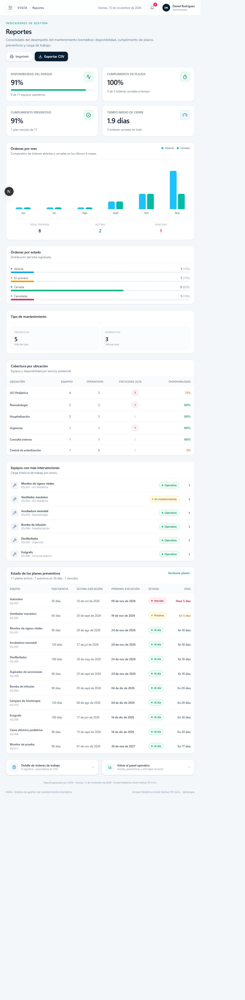

# VIGÍA

Aplicación web para gestionar el mantenimiento de equipos biomédicos: centraliza el inventario, las órdenes de trabajo, los planes preventivos y el historial de intervenciones.

> **Estado:** MVP académico. No está certificado ni debe utilizarse para operar o tomar decisiones clínicas. Los datos incluidos son de demostración; no cargues información real de pacientes ni credenciales de producción.

## Capturas

| Panel de control | Reportes |
| --- | --- |
|  |  |

## Funcionalidades

- **Equipos:** registro y consulta de equipos biomédicos, con estado, criticidad, ubicación e historial de mantenimiento.
- **Órdenes de trabajo:** creación, asignación, seguimiento y cierre de órdenes preventivas y correctivas.
- **Mantenimiento preventivo:** programación por equipo según frecuencia y consulta de próximos vencimientos.
- **Usuarios y roles:** administración de cuentas para técnicos, administradores y gerencia.
- **Panel e informes:** indicadores de mantenimiento y exportación de órdenes a CSV.

## Tecnologías

- [Next.js](https://nextjs.org/) 16 y React 19
- TypeScript y Tailwind CSS 4
- Prisma ORM 6 y SQLite
- Autenticación con sesiones y contraseñas con hash mediante bcrypt

## Requisitos

- Node.js 20.9 o posterior
- npm

## Instalación y ejecución local

1. Clona el repositorio e instala las dependencias:

   ```bash
   git clone https://github.com/danielromo2001/vigia-mvp.git
   cd vigia-mvp
   npm install
   ```

2. Crea el archivo local de variables de entorno:

   ```bash
   cp .env.example .env
   ```

   En Windows PowerShell, usa `Copy-Item .env.example .env`.

   `.env.example` configura SQLite local con `DATABASE_URL="file:./dev.db"`. Cambia `SESSION_SECRET` por un valor aleatorio antes de iniciar la aplicación. Por ejemplo:

   ```bash
   node -e "console.log(require('crypto').randomBytes(32).toString('hex'))"
   ```

3. Crea la base de datos y carga los datos de demostración:

   ```bash
   npm run setup
   ```

4. Inicia el servidor de desarrollo:

   ```bash
   npm run dev
   ```

   Abre [http://localhost:3000](http://localhost:3000).

### Cuentas de demostración

El seed crea estas cuentas locales; todas usan la contraseña `Vigia2026*`:

| Rol | Correo |
| --- | --- |
| Técnico biomédico | `tecnico@vigia.co` |
| Administrador | `admin@vigia.co` |
| Gerencia | `gerencia@vigia.co` |

Estas credenciales son únicamente para desarrollo local. **No las uses ni las publiques en una instancia accesible desde internet.**

## Comandos disponibles

| Comando | Descripción |
| --- | --- |
| `npm run dev` | Inicia Next.js en modo desarrollo. |
| `npm run build` | Genera la compilación de producción. |
| `npm run start` | Sirve la compilación de producción. |
| `npm run lint` | Ejecuta ESLint. |
| `npm run setup` | Sincroniza el esquema y carga los datos de demostración. **El seed borra los datos existentes.** |
| `npm run db:push` | Sincroniza el esquema con la base de datos configurada. |
| `npm run db:seed` | Borra los datos existentes y vuelve a cargar la demostración. |
| `npm run db:studio` | Abre Prisma Studio. |
| `npm run db:reset` | **Destructivo:** elimina los datos y vuelve a cargar la demostración. |

## Estructura del proyecto

```text
src/
  app/          Rutas, páginas, acciones y API
  components/   Componentes de interfaz y formularios
  lib/          Autenticación, Prisma y utilidades
prisma/
  schema.prisma Modelo de datos
  seed.ts       Datos de demostración
docs/           Requerimientos, diagramas y capturas
```

Consulta el [plan del MVP](docs/mvp-plan.md), los [requerimientos](docs/requerimientos.txt) y el [diagrama de arquitectura C4](docs/Diagramas_C4_Mantenimiento_Hospitalario.drawio) para más contexto del proyecto.

## Seguridad y datos

- No subas `.env`, bases de datos locales ni secretos al repositorio.
- Configura un `SESSION_SECRET` único y seguro para cada entorno.
- El seed contiene datos y credenciales de demostración; no es una configuración de producción. Tanto `npm run setup` como `npm run db:seed` borran los datos actuales al ejecutar el seed.
- Revisa y reemplaza la configuración de SQLite antes de desplegar en un entorno compartido.
